# 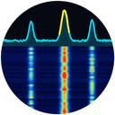 wfscope

**A receive-only spectrum analyser and waterfall for Sailfish OS.**

> 🧪 **Early stage — very experimental.** This is a first public snapshot of a
> research project. Features are incomplete, levels are uncalibrated, and the
> Wi-Fi chip source drives undocumented vendor test interfaces. Expect rough
> edges and breakage; do not rely on it.

wfscope shows a live spectrum with frequency axis and a scrolling waterfall. It
only **listens** — it never transmits, never connects to anything it observes
and never interferes. Everything runs on the device; there is no telemetry and
no cloud component.

> ⚠️ **Scope & legality.** This is a passive *receiver*. It does not jam, spoof
> or interfere with anything. Whether and how you may use radio-analysis tools
> can depend on your jurisdiction — you are responsible for using it lawfully.

## Screenshots

Phone's own Wi-Fi chip (ICAP), 2.4 GHz band with traffic on channel 11, and the
5 GHz band — spectrum with frequency axis on top, waterfall below (newest row on
top):

<p>
  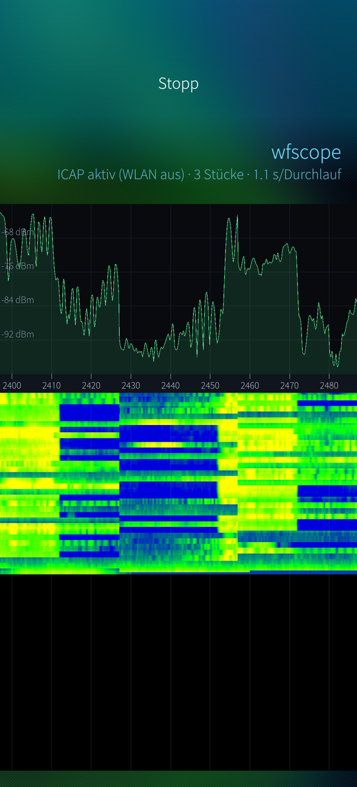
  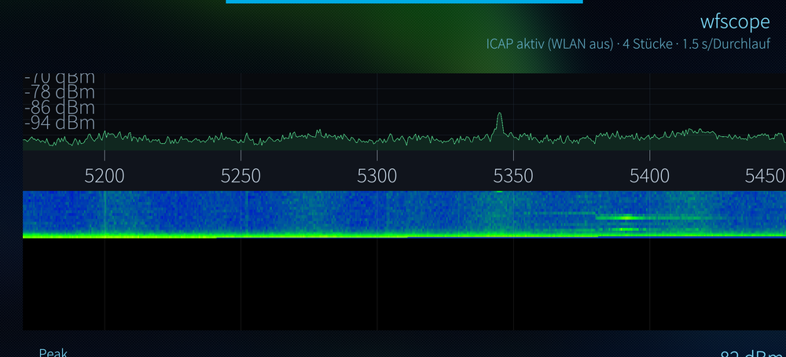
</p>

## Sources

| Source | What it gives | Needs |
|---|---|---|
| **Synthetic** | demo signals | nothing |
| **FM radio (internal)** | 87.5–108 MHz band scan (level per 100 kHz channel), **audio** of the tuned station, **RDS station names** (verified by the station's PI code, editable by hand) | an antenna in the USB-C socket: 75 cm wire on the SBU pin or a fully wired USB-C cable (see below); no root, Wi-Fi stays on |
| **Wi-Fi chip (ICAP)** | 2.4/5 GHz Wi-Fi bands from the phone's own MediaTek connac2x Wi-Fi chip: 32 768 IQ samples per capture at 320 MS/s (102.4 µs snapshots), stepped in 40/80 MHz pieces | root (helper `wfscope-icap`); Wi-Fi is **off** while it runs |
| **HackRF One / PortaPack** (HackRF mode) | 1 MHz – 6 GHz in sweep mode (20 MHz steps, 78 kHz bins); 2.4 + 5 GHz in one view | USB-OTG, USB access to the device |
| **SDRplay RSPdx** (optional) | 1 kHz – 2 GHz, 8 MHz per tuning; **panadapter mode** for a transceiver's first IF (e.g. an IF tap board, default 69.450 MHz), axis shown in VFO frequency, mirror switch, fine offset | USB-OTG, the separately installed SDRplay API (`sdrplay_apiService` running) |

### FM radio (internal)

<p>
  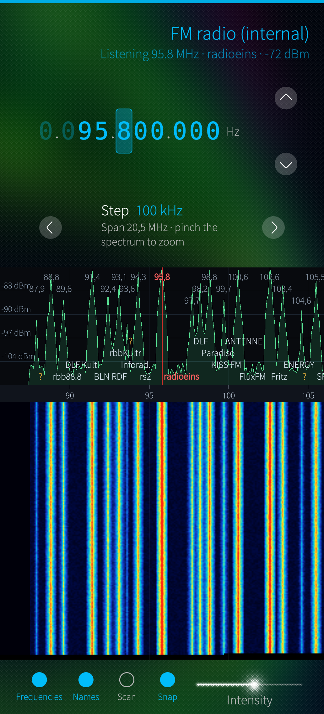
  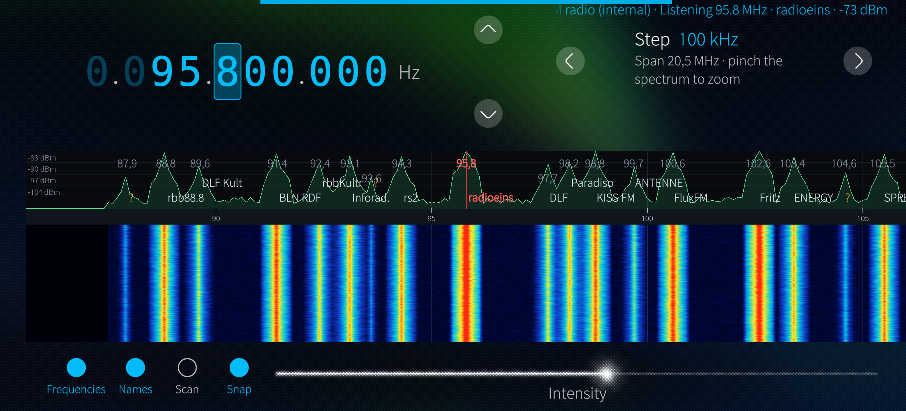
</p>

*Screenshots in demo mode (`WFSCOPE_FM_DEMO=1`): a typical FM band as seen
around the Brandenburg Gate in Berlin — no real reception.*

- Slide a peak under the red centre line, or tap it; the line snaps to the
  nearest peak (switchable). The app starts on the last used frequency.
- **Antenna:** on devices without a headphone jack, the FM antenna goes into
  the USB-C socket. Best: a 75 cm wire on the SBU pin of a USB-C plug (see
  below). A fully wired USB-C cable also works; let it hang straight and leave
  the other end unconnected (a laptop adds noise).
- While listening the chip cannot scan the band; "Scan" pauses the audio for
  about 10 s and refreshes the band picture.
- RDS needs a clearly stronger signal than audio. Where no name is received,
  a "?" explains why and lets you enter one.

### FM antenna on the USB-C SBU pins

The FM antenna input is wired to the **SBU1/SBU2 pins (A8/B8)** of the USB-C
socket — the side-band pins that analogue USB-C headsets also use. A cable
therefore only works as an antenna if it carries the SBU wires:

- **works:** fully wired USB 3.x / USB4 cables (e.g. 40 Gbps, with e-marker);
  tested with a 1.3 m USB4 cable;
- **does not work:** simple charging cables and USB 2.0 cables — they have no
  SBU wires.

Found with a USB-C breakout board and a probe (acting as a short antenna) on
the SBU pads:

<p>
  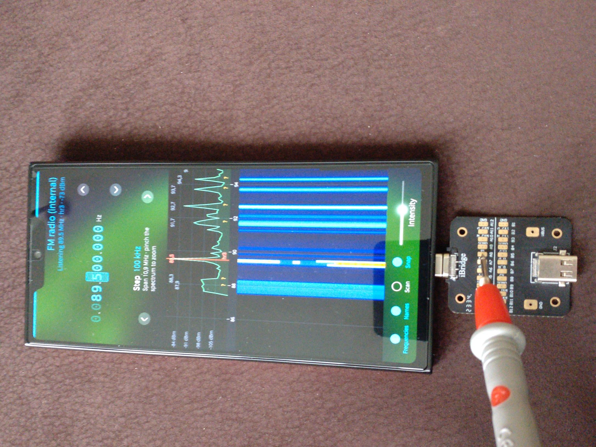
  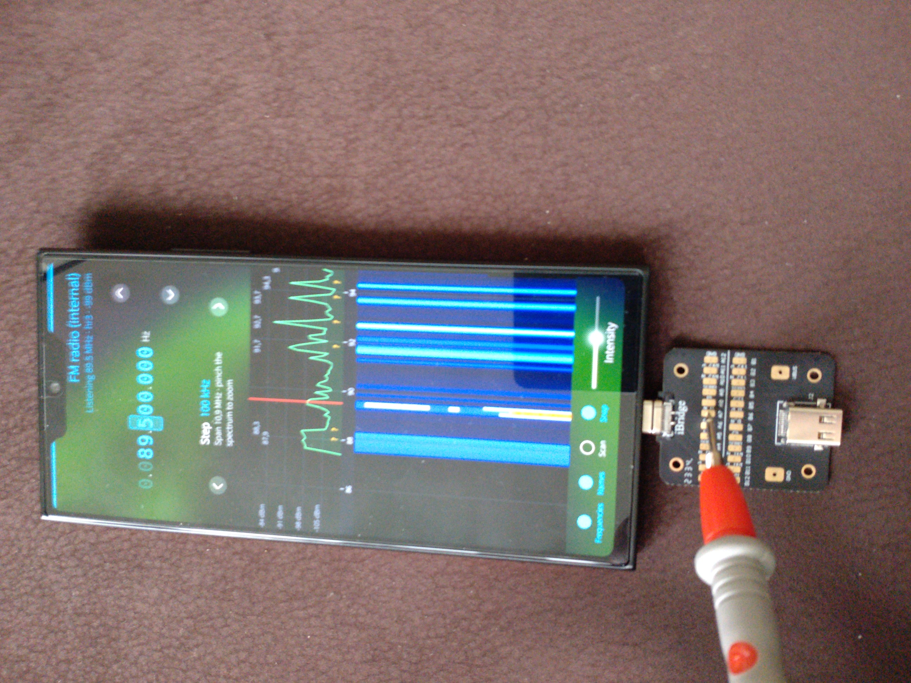
  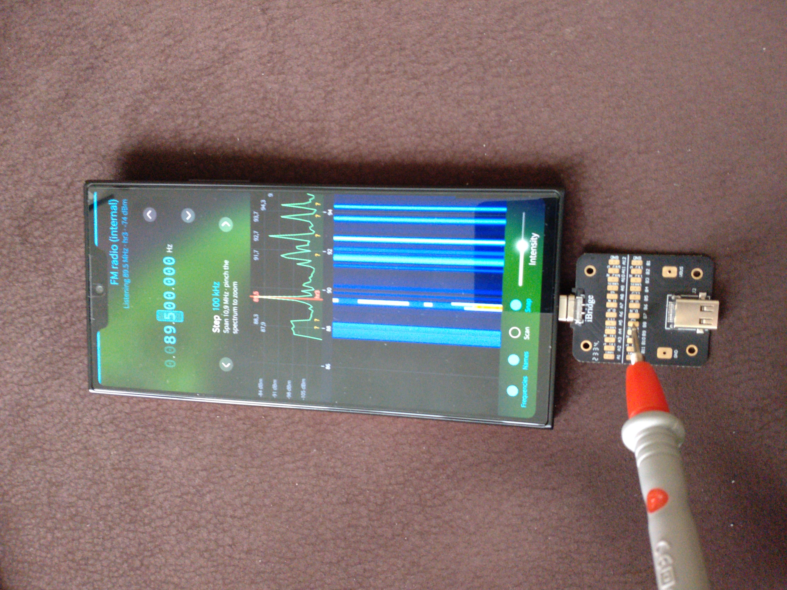
</p>

### DIY FM antenna: 75 cm wire on A8

The best antenna so far is a single wire on a USB-C plug breakout:

- solder a **75 cm** insulated wire to **A8** (SBU1) — a quarter wavelength in
  the middle of the FM band (λ/4 at 98 MHz ≈ 76 cm, a little shorter for
  insulated wire). Nothing else on the plug is needed: no CC resistors, no
  ground wire. Thanks to the SBU switch either plug orientation works;
- lay the wire out straight.

<p>
  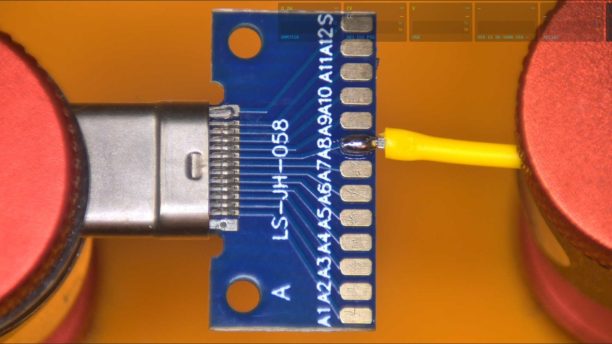
  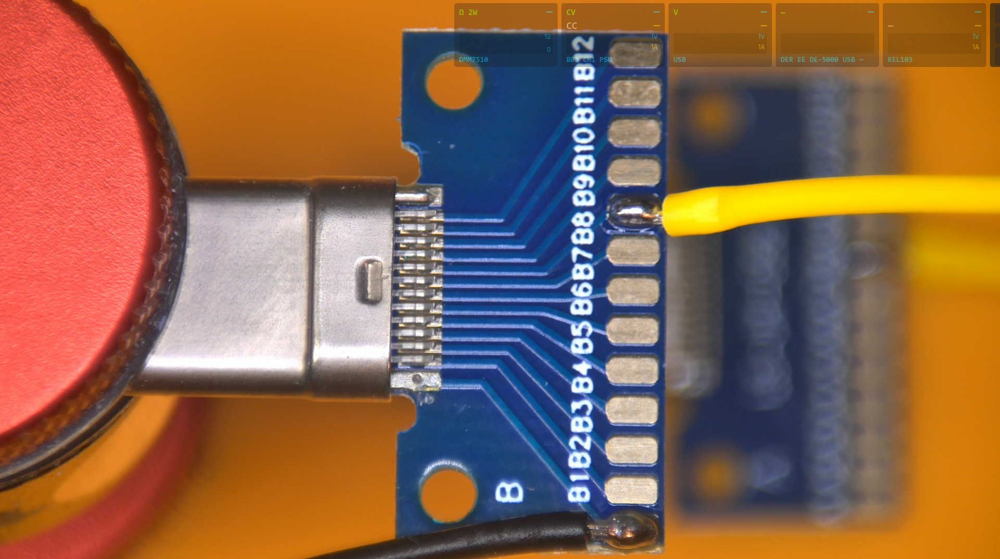
</p>
<p>
  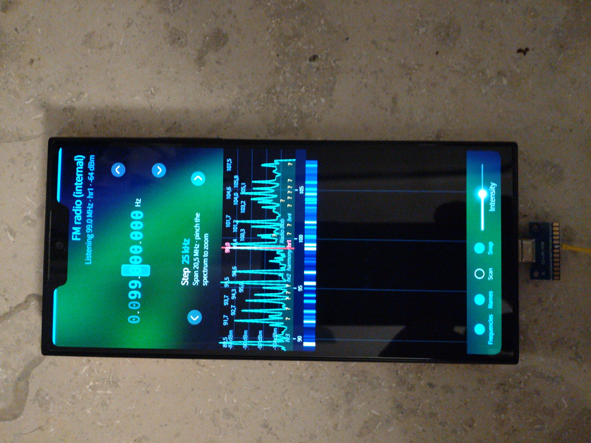
  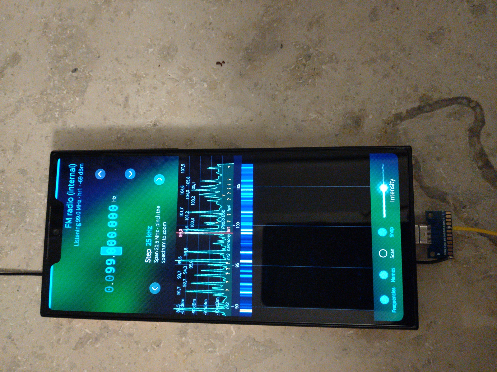
</p>
<p>
  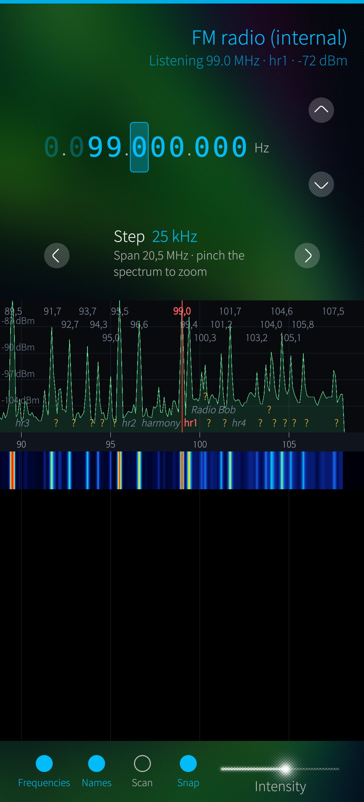
  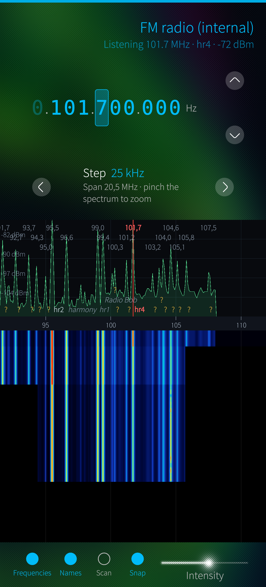
</p>

Measured band scans (87.5–108 MHz, 206 channels, same place, phone lying still):

| Antenna | Noise floor | Strongest station | Channels the chip reports as valid |
|---|---|---|---|
| 1.3 m USB4 cable to a laptop | −92 dBm | −71 dBm | 3 |
| **75 cm wire on A8** | **−104 dBm** | **−52 dBm** | **38–39** |
| dipole: 75 cm on A8 + 75 cm on GND (B12) | −105 dBm | −66 dBm | 32–33 |

- The single wire gives about 50 dB between the strongest station and the
  noise floor (cable: about 20 dB), and the phone's own interference spikes
  disappear. Audio is clearly cleaner than with the USB cable.
- The dipole is **worse** by 4–16 dB on almost every station although both arms
  were laid out straight. The SBU input is made for a headset wire working
  against the phone's ground, i.e. a high-impedance input; a centre-fed dipole
  (about 70 Ω) delivers less voltage there. Skip the ground wire.
- The driver's antenna switch (short/internal vs. long/headset) makes no
  difference: the input is simply the SBU pin.

### Wi-Fi chip (ICAP) — read this first

- The capture runs the Wi-Fi chip in **RF test mode**; normal Wi-Fi is down for
  the whole session. The root helper restores it on exit, on stdin EOF, on
  SIGTERM, and through a detached watchdog even if the helper is killed
  (abort test mode, then a connman Wi-Fi power cycle). Never write `0` to
  `/dev/wmtWifi` yourself — that powers the chip off.
- The app starts the helper through `pkexec`. No polkit rule is installed by
  the package; either run wfscope as root or add a polkit rule for
  `/usr/libexec/wfscope/wfscope-icap` yourself, knowing that it lets the
  permitted user switch Wi-Fi into test mode.
- ⚠️ **This source can crash the phone.** Twice, 15–30 minutes after ICAP
  sessions, the device rebooted: once a kernel BUG in the vendor Wi-Fi driver's
  error-recovery path after a TX stall, once a hardware-watchdog reset. Until
  the cause is understood, treat this source as unsafe — do not use it on a
  device you depend on, and never leave it running unattended.
- Levels are **uncalibrated** (dB relative, not dBm).

### HackRF / SDRplay

- The app opens the HackRF through libusb; a normal user needs a udev rule
  granting access to the HackRF's USB IDs, or run as root.
- SDRplay support is compiled only if `sdrplay_api.h` is found (in
  `3rdparty/sdrplay_api/inc/` or `/usr/local/include`). The SDRplay API is
  proprietary and is **not** part of this repository or the packages; the
  library is loaded with `dlopen` at run time. Its headers must never be
  committed here.

## Building

Requires the [Sailfish OS SDK](https://sailfishos.org/develop/). From the
project root:

```sh
mb2 -t SailfishOS-<version>-aarch64 build    # produces an RPM under RPMS/
```

Install on the device:

```sh
scp RPMS/wfscope-*.aarch64.rpm <device>:/tmp/
ssh <device> 'pkcon install-local -y /tmp/wfscope-*.aarch64.rpm'
```

## Status & responsible use

**Early stage, very experimental proof of concept**, shared **as is** with **no warranty**
of any kind (see the GPLv3). The ICAP path relies on undocumented vendor test
interfaces and may stop working, or misbehave, with other firmware or driver
versions. How you use it is your responsibility.

---

AI assisted development

## License

The user interface is available in 32 languages (selectable on the About page).

Licensed under the **GNU General Public License v3.0 or later** (see
[`LICENSE`](LICENSE)), with an additional permission under section 7 for
combining with the SDRplay API (see [`LICENSE-EXCEPTION`](LICENSE-EXCEPTION)).
Anyone distributing wfscope or a modified version must provide the source code
under the same terms. The bundled libhackrf and tinyalsa keep their BSD-3-Clause licences, see
[`THIRD-PARTY-NOTICES.md`](THIRD-PARTY-NOTICES.md).
